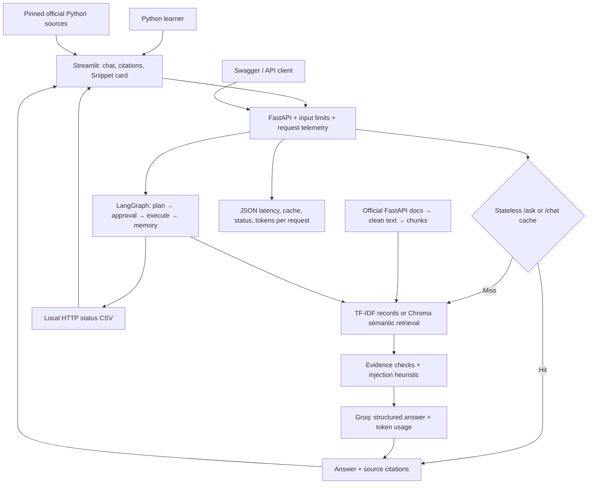

[](https://github.com/Ayaj04/Gen-ai/actions/workflows/ci.yml)
# FastAPIGuide

**Learn FastAPI with answers you can trace back to the docs—and examples you can run.**

FastAPIGuide helps Python beginners turn a question into a documentation-grounded
answer, source citations, and a copyable Python example. It combines a FastAPI
backend, a Streamlit learning interface, and an approval-based tool agent.

[Try the live API](https://gen-fast-api.onrender.com/docs) ·
[Health check](https://gen-fast-api.onrender.com/health) ·
[Watch the demo video](docs/demo.webm?raw=true) ·
[Resume bullets](docs/resume.md)

## Day 14 checkpoint

Day 14 S1/S2 revalidates the production safeguards and project showcase introduced
on Day 13. Ruff and all **36 tests passed** again. A new local smoke check measured
`/health` at **3.761 ms median over 10 requests**; an overlong question and an
instruction-override attempt both returned **HTTP 422 with zero provider tokens**.
The original real-Groq cache measurements remain labeled separately below.

[Day 14 checklist and verification](docs/day14.md) ·
[Fresh health/validation measurements](eval/day14_checks.json)

## The problem

Beginners often know what they want to build but struggle to find the right
tutorial section, connect an error to its cause, or distinguish an API example
from an unsupported suggestion. A fluent chatbot answer alone does not solve
that problem.

FastAPIGuide retrieves official FastAPI documentation, attaches source citations,
and provides the corresponding tutorial source file in a Snippet card.
When the dataset cannot support a RAG answer, it responds with "I don't know."
For HTTP-status questions, a local lookup can explain the error without an LLM call.

## What you can do

- Ask FastAPI questions through `/ask` (RAG) or `/chat` (record-based retrieval).
- Follow citations to the documentation; browse 20 pinned official Python examples,
  copy their code, inspect the source file, or download an example.
- Use `/agent` to review a proposed tool call, approve or reject it, and ask a
  follow-up using the thread's short-term memory.
- Rate an answer with thumbs up/down in Streamlit; feedback is saved locally.
- Inspect API endpoints in Swagger and request metrics in structured server logs.

The [demo recording](docs/demo.md) shows the real local app: an HTTP 404 question,
agent approval, the answer, and the Snippet card. It does not simulate a Groq answer.
If GitHub shows a file page, use **Download raw file** to play the WebM.


[Chat and feedback screenshot](docs/checkpoint2_chat.png) ·
[Phone-width controls](docs/checkpoint2_streamlit_mobile.png)

## Architecture



The embedding model, ChromaDB, scikit-learn, and LangGraph load only when a
request needs them. Startup and `/health` do not load the embedding model.
Stateful agent responses bypass the answer cache.

## Results

| Evidence | Result | Scope |
| --- | --- | --- |
| Documentation dataset | 21 records; 20 bundled Python examples | Local bundled corpus |
| Recorded retrieval evaluation | 13/14 in-scope questions retrieved an expected page | [Day 08 saved evaluation](eval/eval_runs.json); not rerun for Day 13 |
| Recorded cited answers | 12/14 in-scope questions produced a non-refusal with valid source citations | Same saved evaluation; not an independent factual-accuracy score |
| Out-of-scope question | Q6 abstention passed for both tested configurations | AWS ECS / Terraform / CI-CD is outside the corpus |
| Regression suite | 36 tests passed; Ruff passed | Revalidated for Day 14, Python 3.14.5; CI targets Python 3.11 |
| Public deployment | `/health` and `/docs`: HTTP 200; 21 records | Render, verified 23 November 2026 |
| Live local `/ask` sample | 3,756.658 ms uncached; 3.111 ms median across 5 cache hits | Real Groq call; see Production notes |

## Run locally

From the repository root:

```powershell
py -m venv .venv
.\.venv\Scripts\Activate.ps1
python -m pip install -r requirements.txt
Copy-Item .env.example .env
```

Set `GROQ_API_KEY` in your local `.env`. The default `GROQ_MODEL` is
`openai/gpt-oss-20b`. Do not commit credentials.

```powershell
python -m app.vectorstore
python -m uvicorn app.main:app --reload
```

In another terminal with the same environment:

```powershell
python -m streamlit run ui/app.py
```

Open http://localhost:8501 for Streamlit or http://127.0.0.1:8000/docs for the API.
Form/file tutorial examples need `python-multipart`; email-validation examples
may need `email-validator`.

Example request:

```json
{"question": "How do I handle errors in FastAPI?", "top_k": 3}
```

Send it to `POST /ask`. Agent requests use a `thread_id` and a question;
resume the same thread with `{"thread_id":"demo1","approve":true}`.

| Route | Purpose |
| --- | --- |
| `GET /health` | Lightweight liveness and record count |
| `GET /records`, `GET /records/{id}` | Browse the collected documentation records |
| `GET /search?q=...` | TF-IDF search |
| `GET /search/semantic?q=...` | Embedding-based chunk search |
| `POST /questions` | Save a question in process memory and suggest a record |
| `POST /chat` | Record-grounded answer with confidence and follow-up |
| `POST /ask` | RAG answer with checked citation numbers |
| `POST /agent` | Tool plan, human approval, execution, and thread memory |

## Production notes

Day 14 local health/validation recheck: 10 successful `/health` requests
(3.761 ms median); 501-character question rejected in 7.636 ms; injection
attempt rejected in 3.795 ms. Both rejections returned HTTP 422, and all 12
requests used zero provider tokens. [Raw recheck samples](eval/day14_checks.json).
This recheck did not make new Groq calls or remeasure uncached/cached LLM latency.

### Measured latency and tokens

Measured on **23 November 2026**, Windows, Python 3.14.5, one process using
FastAPI TestClient, real Groq `openai/gpt-oss-20b`, and the question
"How do I handle errors in FastAPI?". The Chroma index already existed on disk.
Times below are end-to-end local TestClient times, including retrieval/model
initialization on the first relevant request. They are **not Render latency,
throughput benchmarks, or latency guarantees**.

| Route / case | Samples | Latency (ms) | New provider tokens per request |
| --- | ---: | ---: | ---: |
| `/health` | 10 | 3.587 median | 0 |
| `/ask` uncached | 1 | 3,756.658 | 1,400 |
| `/ask` cache hit | 5 | 3.111 median | 0 |
| `/chat` uncached | 1 | 6,722.022 | 1,279 |
| `/chat` cache hit | 5 | 2.695 median | 0 |
| `/ask` overlong question | 1 | 3.035; HTTP 422 | 0 |
| `/ask` instruction-override attempt | 1 | 3.279; HTTP 422 | 0 |

[Raw samples and request logs](eval/production_results.json) record every request,
including separate prompt/completion/total token counts. The two uncached calls
used 2,679 provider tokens in total; ten cached repeats made no additional LLM calls.
Cached JSON responses were checked against their uncached responses.

Reproduce health/validation checks without a provider call:

```powershell
python -m eval.run_production_eval --output eval/production_checks.json
```

Reproduce the live run (requires your Groq key; makes two provider calls and may
incur usage charges):

```powershell
python -m eval.run_production_eval --live
```

### Logging and cache

- Each HTTP request emits one JSON event: generated request ID, method, route
  template, status, latency in milliseconds, cache status, LLM-call count, and
  prompt/completion/total tokens. The application event omits question/answer
  text, query strings, credentials, and client IPs.
- Token counts come from [Groq's response usage](https://console.groq.com/docs/api-reference).
  A request making no provider call records zero tokens; unavailable or failed
  provider usage is `null` with `usage_known: false`, never an estimated zero.
- Response headers expose `X-Request-ID`, `X-Process-Time-Ms`, `X-Cache`, and
  `X-Total-Tokens` (`unknown` when provider usage is unavailable).
- `/ask` and `/chat` cache validated successful responses for **300 seconds**,
  capped at **128 entries** with LRU eviction. Keys include the trimmed question,
  endpoint, model, and `top_k` or prompt version. Errors are not cached.
- Cache and agent memory are process-local, disappear on restart, and are not
  shared across workers. Concurrent identical misses may both call Groq.
  Restart after changing docs/prompts to invalidate existing answers immediately;
  otherwise entries expire within five minutes. Do not use this shared answer
  cache for personalized/private responses without adding user isolation.

### Limits and injection regression

- JSON request body: **16,384 bytes**, enforced before parsing, including streamed
  bodies without Content-Length; excess returns HTTP 413.
- Questions: **3–500 characters after trimming** across `/ask`, `/chat`,
  `/questions`, and `/agent`; blank/overlong questions return HTTP 422.
- Search: **1–500 trimmed characters**; thread IDs: **1–100**;
  `top_k` and semantic result limit: **1–10**.
- Groq output: **1,024 maximum completion tokens**; SDK timeout: **30 seconds**,
  automatic SDK retries disabled. Retrieval and server queue time are additional;
  this is not a whole-request deadline.
- [Injection regression](tests/test_production.py) checks that an explicit
  instruction-override/secret-extraction question is rejected before a provider
  call and that a poisoned retrieved chunk is discarded before generation.
- The guard is a small keyword heuristic plus grounded system instructions and
  citation checks. It can miss obfuscated attacks or reject benign quoted text.
  One regression test does not establish general prompt-injection resistance.

This is a learning deployment: no authentication, rate limiter, durable agent
memory, or production load/SLA validation. Logs go to the server's log stream.
Rebuild/redeploy Render when updating the service. Local measurements do not
establish that the live service runs this source revision.

## Docker and Render

```powershell
docker build -t fastapiguide-option-a:day14 .
docker run --rm -p 8000:8000 --env-file .env fastapiguide-option-a:day14
```

Or run backend and frontend with `docker compose up --build`.
The Docker build verifies and caches MiniLM on disk; the API loads it lazily.
Render uses the included Dockerfile, `0.0.0.0`, and its supplied `PORT`.
Set `GROQ_API_KEY` and optionally `GROQ_MODEL` in Render; use `/health` for
health checks and one worker for the 512 MB RAM instance. The first RAG request
may build the local index from the bundled raw documentation.

Live deployment: https://gen-fast-api.onrender.com/

Health: https://gen-fast-api.onrender.com/health

Swagger: https://gen-fast-api.onrender.com/docs

On 23 November 2026 the public health response was
`{"status":"ok","records":21}` with HTTP 200; Swagger also returned HTTP 200.

## Tests and project history

```powershell
python -m pip install -r requirements-dev.txt
python -m ruff check .
python -m pytest -q
```

CI runs Ruff, Pytest, and a Docker build on main pushes and pull requests to main.
[Historical checkpoints](docs/history.md) preserve the Day 01–12 notes.
The `day-10` tag marks the reviewed Snippet card fix; both
[Swagger](docs/checkpoint1_swagger.png) and
[Streamlit](docs/checkpoint2_streamlit.png) screenshot files are committed.

Official tutorial examples retain their [MIT license](data/FASTAPI_SNIPPETS_LICENSE.txt).
