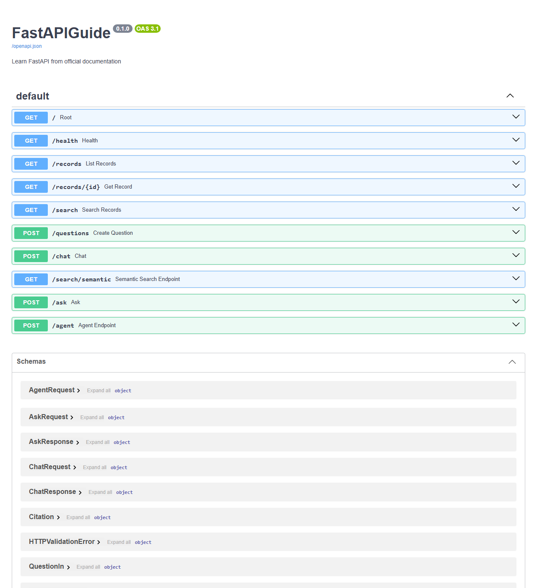
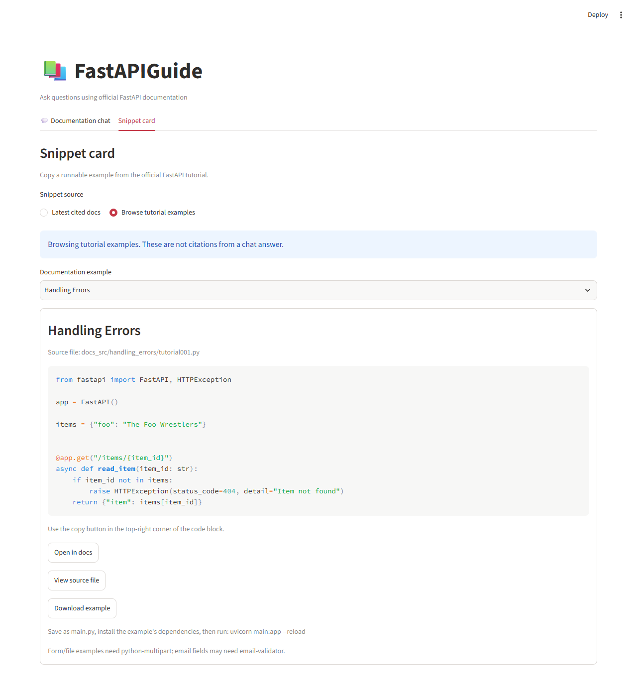

# FastAPIGuide

## Product
FastAPIGuide is a beginner-friendly project that helps students understand FastAPI and the basics of building APIs using Python.

## User
Python beginners, college students, and aspiring backend developers.

## Problem
Beginners may find it difficult to understand API concepts, endpoints, HTTP requests, and responses. FastAPIGuide aims to make these concepts easier to learn through simple explanations and examples.

## Data Source
Official FastAPI documentation: https://fastapi.tiangolo.com/

The project may also use sample questions, example inputs, and demonstration API responses for learning purposes.

## Project Files
- day01_intro.py — Displays the project information and interacts with the user.
- day01_menu.py — Provides an interactive learning menu.


## How to run

### 1. Create and activate a virtual environment

Windows PowerShell:

    py -m venv .venv
    .\.venv\Scripts\Activate.ps1

### 2. Install dependencies

    python -m pip install -r requirements.txt

### 3. Run the API

    python -m uvicorn app.main:app --reload

Open http://127.0.0.1:8000/docs

### 4. Available endpoints

- GET /health
- GET /records?limit=5
- GET /records/{id}
- GET /search?q=HTTPException
- POST /questions

### 5. Explore documentation data

    python -m analysis.explore

### 6. Search method

Smart Search uses TF-IDF and cosine similarity to
rank FastAPI documentation records.

Data source: https://fastapi.tiangolo.com/tutorial/


## 7. Starter User Questions

1. What is FastAPI?
2. How to create an API using FastAPI?
3. How to handle requests and responses in FastAPI?
4. How do I use path parameters in FastAPI?
5. How do I validate a JSON request body using Pydantic?
6. How can I deploy FastAPIGuide to AWS ECS using Terraform and a CI/CD pipeline?

Question 6 is intentionally not covered by the current dataset.


## Day 05 - Checkpoint 1

### How LLMs Work
See [LLM Explanation](docs/how_llms_work.md).

### User Questions
See [10 User Questions](docs/user_questions.md).

### Run FastAPIGuide

    python -m uvicorn app.main:app --reload

Open Swagger UI:
http://127.0.0.1:8000/docs

### Checkpoint Screenshot


### Function Explained

The `get_record()` function in `app/main.py` retrieves
a documentation record using its ID.

If the ID does not exist, the endpoint returns HTTP 404.

Official reference:
https://fastapi.tiangolo.com/tutorial/handling-errors/#use-httpexception

### Current Limitation

FastAPIGuide uses TF-IDF and cosine similarity
for document retrieval. It does not currently
use an LLM to generate answers.

## Day 06 - LLM Chatbot

FastAPIGuide now supports LLM-based question answering
using Groq.

### Setup

1. Install dependencies:

       python -m pip install -r requirements.txt

2. Copy `.env.example` to `.env`.

3. Add your Groq API key to `.env`.

4. Run the API:

       python -m uvicorn app.main:app --reload

5. Open http://127.0.0.1:8000/docs

### Chat Endpoint

POST /chat

Example request:

    {
      "question": "How do I handle errors in FastAPI?",
      "prompt_version": "v2"
    }

The response contains:
- answer
- confidence
- follow_up

### Prompts

- prompts/system.txt
- prompts/task_v1.txt
- prompts/task_v2.txt

### Evaluation

See eval/prompt_compare.md for the results of testing
two prompt versions on 10 user questions.

### Security

The real API key is stored in .env, which is excluded
from Git. Only .env.example is committed.

### Limitations

LLM responses are not guaranteed to be correct.
Some questions cannot be answered using the current
documentation dataset.

## Day 07 - Semantic Search

FastAPIGuide now supports embedding-based semantic search
using Sentence Transformers and ChromaDB.

### Create document chunks

    python -m app.chunking

### Test embeddings

    python -m app.embed

### Evaluate 10 user questions

    python -m eval.run_search_eval

Results are recorded in:
eval/search_results.md

### Build the Chroma vector index

    python -m app.vectorstore

The index is saved locally in data/chroma/.

### Start the API

    python -m uvicorn app.main:app --reload

Open http://127.0.0.1:8000/docs

### Semantic Search Endpoint

GET /search/semantic?q=How%20do%20I%20handle%20errors

The response contains relevant document chunks with
their page titles, source URLs, and vector distances.

### Limitations

Semantic similarity does not guarantee a correct answer.

Some questions, including the AWS ECS deployment question,
are outside the currently collected documentation.


## Day 08 - RAG and Evaluation

FastAPIGuide now uses Retrieval-Augmented Generation (RAG).

The application retrieves relevant FastAPI documentation
chunks from ChromaDB and sends them to Groq for generating
answers with citations.

### Run the RAG API

    python -m app.vectorstore
    python -m uvicorn app.main:app --reload

Open http://127.0.0.1:8000/docs

### Endpoint

POST /ask

Example request:

    {
      "question": "How do I handle errors in FastAPI?",
      "top_k": 3
    }

The response contains an answer and source citations.

If the available documentation cannot answer the question,
the system should respond with "I don't know".

### Evaluation

The evaluation dataset contains 15 questions.

Two configurations are compared using different chunk
sizes and top-k retrieval settings.

Run:

    python -m eval.run_eval

Detailed results are saved to eval/eval_runs.json.

## Day 09 - Tool-Using AI Agent

FastAPIGuide now includes a hand-written agent and a
LangGraph workflow.

### Agent Tools

1. http_status_explainer
   - Reads local data/http_status_codes.csv
   - Uses dictionary lookup
   - No external API calls

2. RAG search
   - Retrieves FastAPI documentation from ChromaDB
   - Uses Groq to generate answers with citations

### LangGraph Workflow

Plan -> Approval -> Execute -> Save Memory

The graph uses InMemorySaver for short-term memory.
The user must approve each tool call before execution.

### Run the agent

Start the API:

    python -m uvicorn app.main:app --reload

Open:

http://127.0.0.1:8000/docs

### POST /agent

Start a question:

    {
      "thread_id": "demo1",
      "question": "What does HTTP 404 mean?"
    }

Approve the pending action:

    {
      "thread_id": "demo1",
      "approve": true
    }

Reject with approve: false.

### Limitations

- Tool selection currently uses Python rules.
- Memory is lost when the server restarts.
- RAG answers depend on the available documentation.
- Human approval is required for every tool call.


## Day 10 - Streamlit UI and Checkpoint 2

### Run the application

Start the FastAPI backend:

    python -m uvicorn app.main:app --reload

Start the Streamlit frontend in another terminal:

    python -m streamlit run ui/app.py

Open http://localhost:8501

### Features

- Interactive chat using /ask or /agent
- Documentation citations
- Thumbs up/down feedback saved locally
- Six profile-chip filters
- Live-updating scheme cards
- Explanation of matching profile fields

### Screenshot



### Limitations

Scheme profile filtering is a demonstration until
real eligibility data is verified and incorporated.

The existing FastAPIGuide RAG chatbot answers FastAPI
documentation questions, not government-scheme questions.

## Run with Docker

### Requirements
- Docker Desktop
- Docker Compose
- A configured `.env` file

### Start the application

```bash
docker compose up --build