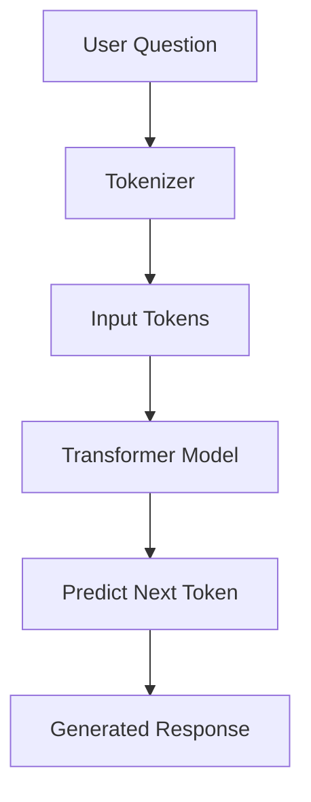

# How Large Language Models Work

## 1. Introduction

A Large Language Model (LLM) is an AI system trained
to understand patterns in text and code and generate
useful responses.

It learns patterns from large amounts of training
data rather than using a fixed list of answers.

## 2. How an LLM works

1. A user enters a question or instruction.
2. The tokenizer converts the input into tokens.
3. The model processes those tokens using a
   Transformer neural network.
4. Attention helps the model use relevant context.
5. The model predicts the next token.
6. It repeats this prediction to produce a response.

## 3. Diagram

## 4. Limitations

LLMs can sometimes produce incorrect information,
even when the response sounds confident.

For technical questions, answers should be verified
using official documentation.

## 5. Connection to FastAPIGuide

My FastAPIGuide project currently uses TF-IDF and
cosine similarity to search FastAPI documentation.

It retrieves relevant records but does not currently
use a Large Language Model to generate explanations.

In the future, I could combine retrieval with an LLM
to produce answers supported by official FastAPI docs.

## 6. Conclusion

LLMs are useful for understanding and generating
language, but reliable technical answers still need
correct sources and verification.
